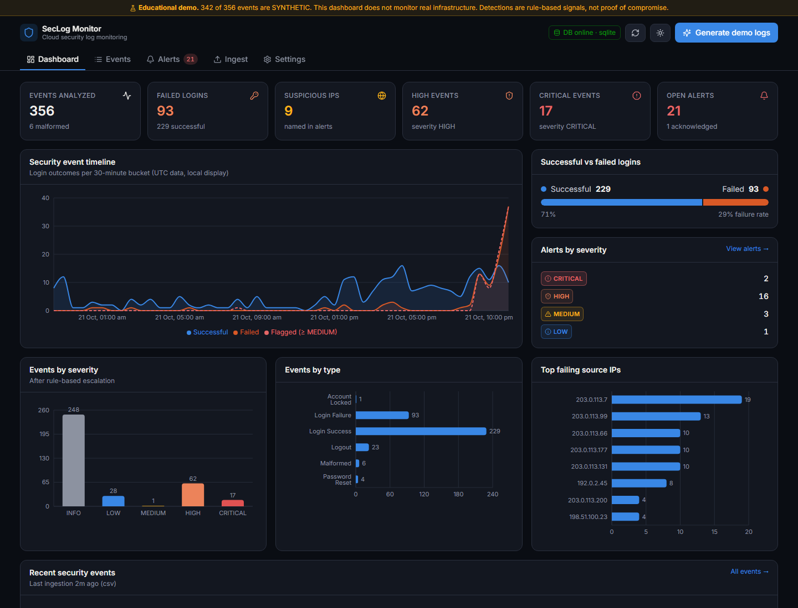
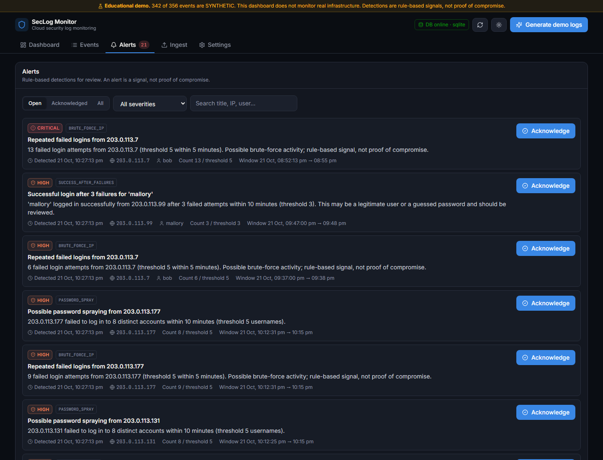
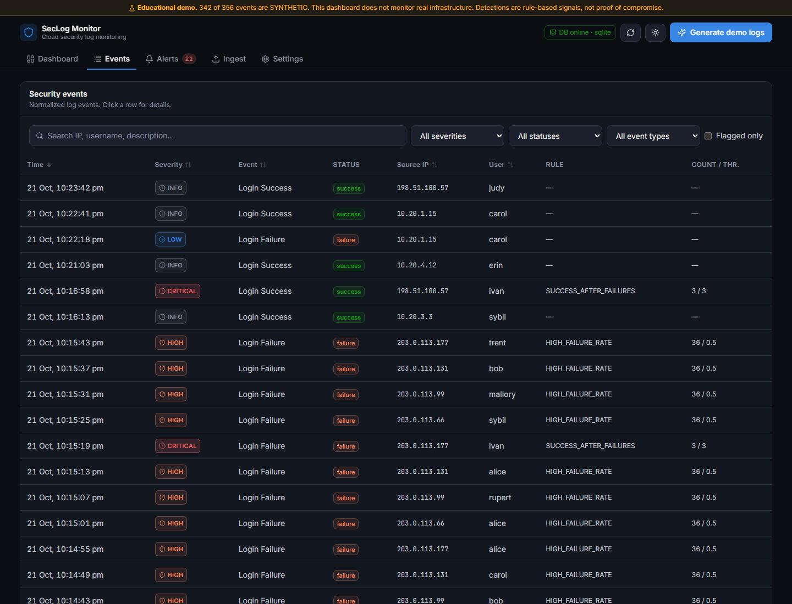
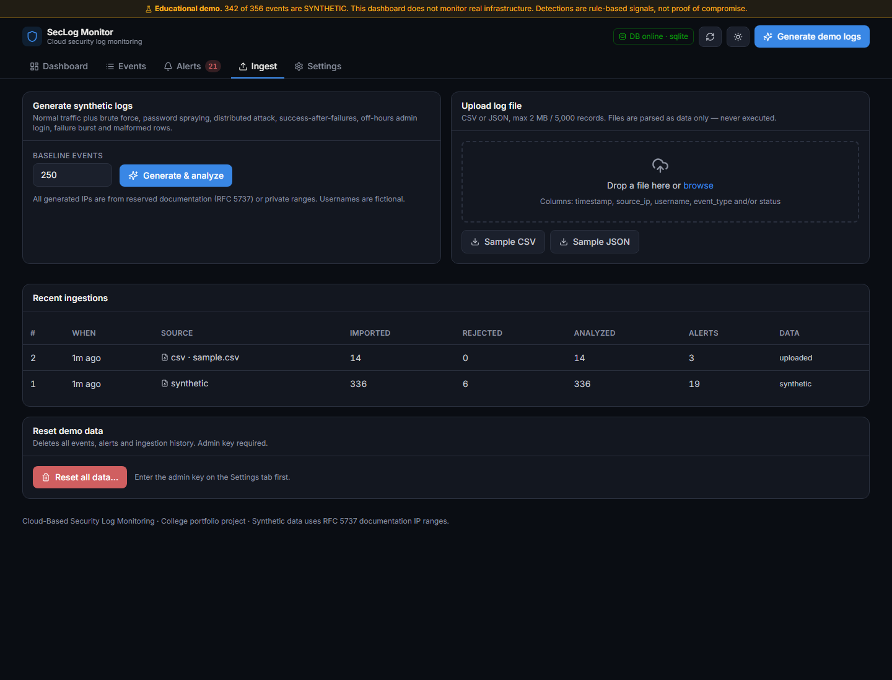
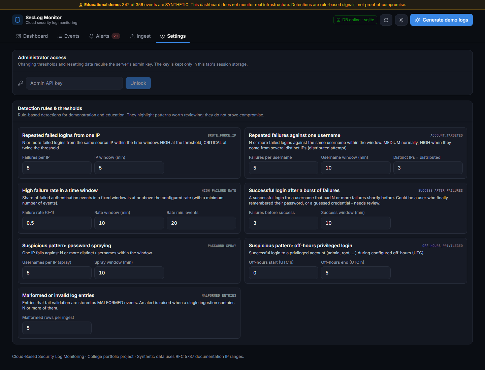
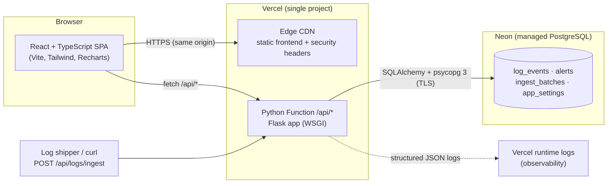

# Cloud-Based Security Log Monitoring Dashboard

A full-stack, cloud-deployed **security log monitoring** application. It ingests authentication logs (synthetic or uploaded), normalizes and validates them, runs **rule-based detections** (brute force, password spraying, success-after-failures, …), raises **alerts** with severities, and visualizes everything on a SOC-style dashboard.

> **Educational demo.** The public deployment runs on **synthetic data**. It does **not** monitor any real infrastructure. Detections are rule-based signals for learning purposes and **do not prove** that an account was compromised.

| | |
|---|---|
| **Live app** | _PUBLIC_URL_ |
| **API health** | _PUBLIC_URL_/api/health |
| **Repository** | _REPO_URL_ |



---

## Contents
- [Features](#features)
- [Architecture](#architecture)
- [Technologies](#technologies)
- [Run locally](#run-locally)
- [Environment variables](#environment-variables)
- [Database](#database)
- [API reference](#api-reference)
- [Detection rules](#detection-rules)
- [Testing](#testing)
- [Deployment](#deployment)
- [Security controls](#security-controls)
- [Cloud concepts demonstrated](#cloud-concepts-demonstrated)
- [Known limitations](#known-limitations)
- [Synthetic data & responsible use](#synthetic-data--responsible-use)

## Features

**Dashboard**
- KPIs: events analyzed, failed logins, suspicious IPs, HIGH and CRITICAL events, open alerts
- Successful vs. failed login split, security event timeline (success / failure / flagged)
- Charts by severity and event type, top failing source IPs, recent events table
- Always-visible banner showing how much of the data is **synthetic**
- Dark mode (default) and light mode, responsive down to phone width

**Log ingestion**
- One-click synthetic log generation with seven built-in attack scenarios
- CSV / JSON / JSON Lines upload (drag & drop), plus a JSON ingestion API for log shippers
- Per-ingestion counts: received, imported, rejected, analyzed, alerts created
- Rejected rows are stored as `MALFORMED` events with the reason (and a sanitized excerpt)
- Downloadable sample CSV and JSON files
- Admin-only “reset demo data” with typed confirmation

**Detection & alerts**
- 7 rule-based detections with configurable thresholds (env vars + admin settings API/UI)
- Severity levels: `INFO`, `LOW`, `MEDIUM`, `HIGH`, `CRITICAL`; events involved in a detection are escalated and tagged with the rule, count and threshold
- Alerts list with severity/status filters, search, acknowledge / unacknowledge

**Events explorer**: full-text search, severity / status / event-type / flagged filters, sortable columns, pagination, expandable row details.

| Alerts | Events |
|---|---|
|  |  |
| **Ingest** | **Settings** |
|  |  |

## Architecture



**Request pipeline:** upload/generate → *decode & validate* (`parsing.py`) → *normalize* to a common schema → *persist* events (`services.py`) → *run detection rules* (`detection.py`) → *escalate events & create alerts* → dashboard queries aggregate via SQL.

Why this architecture: the frontend is static and the API is stateless, so one Vercel project serves both from the **same origin** (no CORS needed). Flask runs as a **Vercel Python Function** (serverless WSGI) instead of a long-running server, and uses `NullPool` so idle serverless instances don’t hold database connections; Neon’s pooled endpoint handles reuse. Locally the same Flask app runs with SQLite.

```
cloud-security-log-monitor/
├── api/index.py            # Vercel Python Function entry (exports the Flask WSGI app)
├── backend/
│   ├── app/
│   │   ├── __init__.py     # app factory
│   │   ├── config.py       # env-based settings + default thresholds
│   │   ├── models.py       # SQLAlchemy schema
│   │   ├── db.py           # lazy engine, schema init, sessions, DB error mapping
│   │   ├── parsing.py      # CSV/JSON parsing, validation, normalization
│   │   ├── synthetic.py    # synthetic log generator (attack scenarios)
│   │   ├── detection.py    # rule engine (pure Python, unit-tested)
│   │   ├── services.py     # ingestion pipeline, alerts, stats, settings
│   │   ├── security.py     # admin auth, rate limiting, headers, IP hashing
│   │   ├── errors.py       # consistent JSON errors
│   │   └── routes.py       # REST API
│   ├── tests/              # pytest: detection, parsing, API, DB failure cases
│   └── run.py              # local dev server
├── frontend/               # React + TS + Vite + Tailwind + Recharts
├── scripts/smoke_test.py   # end-to-end test against any deployment
├── vercel.json             # build, function, rewrites, security headers
└── requirements.txt        # Python runtime deps (used by Vercel)
```

## Technologies

| Layer | Choice |
|---|---|
| Frontend | React 18, TypeScript, Vite 6, Tailwind CSS 3, Recharts, lucide-react |
| Backend | Python 3.12, Flask 3, SQLAlchemy 2, psycopg 3 |
| Database | Neon serverless PostgreSQL (prod), SQLite (local dev / tests) |
| Hosting | Vercel (static CDN + Python Functions) |
| Quality | pytest, ruff, ESLint, Vitest, GitHub Actions CI |

## Run locally

Prerequisites: Python 3.12+, Node.js 20+, Git.

```bash
git clone _REPO_URL_.git
cd cloud-security-log-monitor

# Backend
python -m venv .venv
# Windows: .venv\Scripts\activate    macOS/Linux: source .venv/bin/activate
pip install -r backend/requirements-dev.txt
cp .env.example .env        # then set ADMIN_API_KEY to a long random value
python backend/run.py       # http://127.0.0.1:5000  (SQLite at backend/instance/local.db)

# Frontend (second terminal)
cd frontend
npm install
npm run dev                 # http://localhost:5173  (proxies /api to :5000)
```

Open http://localhost:5173 and click **Generate demo logs**.

To use PostgreSQL locally, set `DATABASE_URL=postgresql://…` in `.env`.

## Environment variables

| Variable | Required | Description |
|---|---|---|
| `DATABASE_URL` | **prod: yes** | PostgreSQL URL (`postgres://` / `postgresql://` accepted). Set automatically by the Vercel ↔ Neon integration. Empty locally → SQLite. `POSTGRES_URL` is used as a fallback. |
| `ADMIN_API_KEY` | recommended | Secret for admin actions (reset, threshold changes). If unset, admin endpoints are disabled (403). |
| `IP_HASH_SALT` | recommended | Salt for hashing client IPs used in rate limiting. Raw visitor IPs are never stored. |
| `CORS_ORIGINS` | no | Comma-separated allowed origins, only if the frontend is hosted elsewhere. |
| `APP_ENV` | no | `production` on Vercel automatically; production refuses to fall back to SQLite. |
| `MAX_UPLOAD_BYTES` | no | Upload cap (default 2 MB). |
| `MAX_RECORDS_PER_INGEST` | no | Records per upload (default 5000). |
| `MAX_STORED_EVENTS` | no | Oldest events are pruned beyond this (default 20000) to keep the public demo bounded. |
| `RATE_LIMIT_INGEST_PER_10MIN` | no | Ingestions per client per 10 min (default 20). |
| `IP_FAILURE_THRESHOLD`, `IP_FAILURE_WINDOW_MINUTES`, … | no | Default detection thresholds (see [Detection rules](#detection-rules)). |

`VITE_API_BASE_URL` (frontend build-time, optional) points the UI at an API on another origin; leave unset for same-origin.

## Database

Schema (created idempotently on first request via `Base.metadata.create_all`, so a fresh Neon database needs no manual migration step):

| Table | Purpose |
|---|---|
| `log_events` | Normalized events: timestamp, source_ip, username, event_type, status, severity, description, detection_rule, rule_count, rule_threshold, is_synthetic, raw (malformed only), batch_id |
| `alerts` | Detections: rule_id, title, description, severity, source_ip, username, failed_attempts, threshold, window_start/end, detected_at, acknowledged(_at), details (JSON) |
| `ingest_batches` | One row per ingestion with received / imported / rejected / analyzed / alerts counts and a hashed client id |
| `app_settings` | Runtime threshold overrides (key/value) |

Indexes cover the common filters (timestamp, severity, IP, username, rule, ack status). If the database is unreachable or not configured, every data endpoint returns `503 database_unavailable` without leaking connection details, and `/api/health` reports `degraded`.

## API reference

All responses use one envelope:

```json
{ "ok": true,  "data": { ... }, "meta": { "page": 1, "page_size": 25, "total": 120, "pages": 5 } }
{ "ok": false, "error": { "code": "validation_failed", "message": "...", "details": { ... } } }
```

| Method | Path | Description | Auth |
|---|---|---|---|
| GET | `/api/health` | Service + database status (200 / 503) | – |
| GET | `/api/stats` | Dashboard aggregates, timeline, data mode | – |
| GET | `/api/events` | Paginated events. Query: `page`, `page_size` (≤200), `severity` (comma list), `status`, `event_type`, `rule`, `ip`, `username`, `flagged=true`, `search`, `sort` (`timestamp`,`severity`,`source_ip`,`username`,`event_type`), `order` | – |
| GET | `/api/alerts` | Paginated alerts. Query: `severity`, `status` (`open`/`acknowledged`/`all`), `rule`, `search`, `sort`, `order` | – |
| PATCH | `/api/alerts/{id}` | `{"acknowledged": true\|false}` | – (rate-limited) |
| POST | `/api/logs/generate` | `{"count": 250, "scenarios": [...]}` → synthetic ingestion | – (rate-limited) |
| POST | `/api/logs/upload` | multipart `file` (.csv/.json/.jsonl) | – (rate-limited) |
| POST | `/api/logs/ingest` | `{"events": [ {...} ]}` (centralized ingestion API) | – (rate-limited) |
| GET | `/api/logs/sample?format=csv\|json` | Download sample log file | – |
| GET | `/api/batches` | Recent ingestions | – |
| GET | `/api/rules` | Rule catalog with current thresholds | – |
| GET | `/api/settings` | Thresholds and limits | – |
| PUT | `/api/settings` | `{"thresholds": {"ip_failure_threshold": 3}}` | **Admin** |
| POST | `/api/admin/verify` | Check an admin key | **Admin** |
| POST | `/api/admin/reset` | `{"confirm": "RESET"}` deletes all data | **Admin** |

Admin endpoints require header `X-Admin-Key: <ADMIN_API_KEY>`.

**Examples**

```bash
# Generate synthetic logs
curl -X POST _PUBLIC_URL_/api/logs/generate -H "Content-Type: application/json" -d '{"count": 250}'
```
```json
{"ok": true, "data": {"batch": {"id": 3, "source": "synthetic", "received": 342, "imported": 336, "rejected": 6,
  "analyzed": 336, "alerts_created": 19, "is_synthetic": true, "created_at": "2026-10-21T17:27:13Z"},
  "alerts_by_severity": {"INFO": 0, "LOW": 1, "MEDIUM": 3, "HIGH": 13, "CRITICAL": 2},
  "rejected_samples": [{"row": 120, "reason": "invalid timestamp format: not-a-date"}]}}
```

```bash
# Upload a CSV file
curl -X POST _PUBLIC_URL_/api/logs/upload -F "file=@sample_security_logs.csv"

# Push events from a log shipper
curl -X POST _PUBLIC_URL_/api/logs/ingest -H "Content-Type: application/json" \
  -d '{"events":[{"timestamp":"2026-10-21T10:00:00Z","source_ip":"203.0.113.7","username":"bob","status":"failure"}]}'

# Open HIGH/CRITICAL alerts
curl "_PUBLIC_URL_/api/alerts?status=open&severity=HIGH,CRITICAL"

# Acknowledge alert 12
curl -X PATCH _PUBLIC_URL_/api/alerts/12 -H "Content-Type: application/json" -d '{"acknowledged": true}'
```

**Accepted log format** (CSV header or JSON keys; common aliases such as `ip`, `user`, `result` are accepted):

```csv
timestamp,source_ip,username,event_type,status
2026-10-21T10:00:00Z,203.0.113.7,bob,LOGIN_FAILURE,failure
```

`event_type` ∈ `LOGIN_SUCCESS, LOGIN_FAILURE, LOGOUT, PASSWORD_RESET, ACCOUNT_LOCKED, MFA_FAILURE` (or a generic `login` + `status`). Timestamps: ISO-8601 or epoch seconds/ms (UTC assumed when no offset).

## Detection rules

| Rule ID | Detects | Default threshold | Severity |
|---|---|---|---|
| `BRUTE_FORCE_IP` | Repeated failed logins from one IP | ≥ 5 failures in 5 min | HIGH; CRITICAL at ≥ 2× threshold |
| `ACCOUNT_TARGETED` | Many failures against one username | ≥ 5 failures in 10 min | MEDIUM; HIGH if from ≥ 3 distinct IPs (distributed) |
| `HIGH_FAILURE_RATE` | High share of failed logins in a fixed window | ≥ 50 % of ≥ 20 attempts in 10 min | MEDIUM; HIGH if ≥ threshold + 25 pts |
| `SUCCESS_AFTER_FAILURES` | Successful login right after a burst of failures | ≥ 3 failures within 10 min before success | HIGH; CRITICAL if ≥ 2× threshold or success from a new IP |
| `PASSWORD_SPRAY` | One IP failing against many accounts | ≥ 5 distinct usernames in 10 min | HIGH |
| `OFF_HOURS_PRIVILEGED` | Privileged account (admin, root, …) success during off-hours | 00:00–05:00 UTC | MEDIUM |
| `MALFORMED_ENTRIES` | Invalid/malformed log rows in one ingestion | ≥ 5 rejected rows | LOW; MEDIUM if ≥ 25 % of the batch |

Bursts are merged so one long attack produces one alert, not dozens. All thresholds are configurable via environment variables (defaults) and at runtime via the admin-protected Settings tab / `PUT /api/settings`. New thresholds apply to subsequent ingestions.

Base severities: successful login/logout = INFO; failed login, MFA failure, password reset = LOW; account locked = MEDIUM. Events that take part in a detection are escalated to the detection’s severity and tagged with the rule, count and threshold.

## Testing

```bash
# Backend: unit + API + persistence + DB failure tests, and lint
cd backend
pytest
ruff check . ../api

# Frontend: lint, unit tests, type-check + production build
cd frontend
npm run lint && npm test && npm run build

# End-to-end smoke test against a running instance (local or production)
python scripts/smoke_test.py http://127.0.0.1:5000
python scripts/smoke_test.py _PUBLIC_URL_
```

Coverage of the required cases (all in `backend/tests/`):

| Case | Test |
|---|---|
| Normal successful login | `test_normal_successful_login_creates_no_alert` |
| One failed login | `test_single_failed_login_creates_no_alert` |
| 5 failures from same IP in 5 min | `test_five_failures_same_ip_within_five_minutes_is_high` (+ below-threshold / outside-window / CRITICAL variants) |
| Failures from multiple IPs | `test_failures_from_multiple_ips_trigger_distributed_account_rule_not_ip_rule` |
| Success after repeated failures | `test_success_after_repeated_failures`, `test_success_after_single_typo_is_not_flagged` |
| Invalid timestamps | `test_invalid_timestamps_are_rejected` (5 variants) |
| Missing required fields | `test_missing_required_fields`, `test_missing_event_type_and_status` |
| Invalid CSV/JSON uploads | `test_invalid_files` (10 variants), `test_invalid_uploads`, `test_upload_too_large` |
| Empty log files | `test_invalid_files[empty…]`, `test_invalid_uploads` |
| Alert acknowledgment | `test_alert_acknowledge_workflow` |
| DB errors / unavailable config | `test_database_not_configured`, `test_database_unreachable`, `test_production_requires_database_url` |
| API error responses | `test_events_bad_params`, `test_unknown_route_and_method`, `test_generate_validation`, `test_reset_requires_admin_and_confirmation`, `test_rate_limit` |

_TEST_RESULTS_

## Deployment

The project deploys as **one Vercel project** connected to this GitHub repository:

1. **Vercel → Add New → Project → Import** the GitHub repository (root directory = repo root). `vercel.json` sets the build (`npm --prefix frontend run build`), output (`frontend/dist`), the Python function (`api/index.py`) and the `/api/*` rewrite.
2. **Storage → Create Database → Neon (Postgres)** and connect it to the project. This injects `DATABASE_URL` (and related variables) as encrypted environment variables. Neon’s free plan is sufficient.
3. **Settings → Environment Variables:** add `ADMIN_API_KEY` and `IP_HASH_SALT` (long random strings) for Production.
4. **Redeploy.** Tables are created automatically on the first request. Verify with `/api/health` and `python scripts/smoke_test.py <url>`.

Every push to `main` triggers a new production deployment; GitHub Actions runs the test suites on each push / PR.

## Security controls

- **No secrets in code**: everything comes from environment variables; `.env` is git-ignored and `.env.example` holds placeholders only.
- **Access control**: destructive/admin operations (reset, threshold changes) require `X-Admin-Key`, compared in constant time; disabled entirely when no key is configured. Public visitors can only read, generate demo data, upload, and acknowledge alerts.
- **Safe ingestion**: uploads are size-limited (2 MB / 5,000 records), must be UTF-8 text, binary content and unknown extensions are rejected, and each field is validated (IP via `ipaddress`, strict username pattern, bounded timestamps, enumerated event types). Content is parsed as data only, never executed or evaluated; malformed rows are stored sanitized and truncated, and React escapes all rendered text.
- **Rate limiting**: per-client limits on write endpoints (in-memory) plus a database-backed ingestion quota that holds across serverless instances. Client IPs are salted and hashed (SHA-256), never stored raw.
- **Bounded storage**: the oldest events and alerts are pruned beyond configurable limits.
- **Security headers**: CSP, `X-Frame-Options: DENY`, `nosniff`, `Referrer-Policy`, `Permissions-Policy` (frontend via `vercel.json`, API via Flask); HTTPS/HSTS by Vercel.
- **Error hygiene**: consistent JSON errors; database failures are logged server-side and returned as a generic 503.
- **Data labelling**: synthetic data is flagged per event/alert/batch and announced in a persistent banner.

## Cloud concepts demonstrated

| Concept | Where |
|---|---|
| Centralized logging | All sources (generator, uploads, `POST /api/logs/ingest`) land in one managed Postgres store |
| Event ingestion & normalization | `parsing.py` maps varied field names/formats into one schema; rejects are kept as `MALFORMED` events |
| Security monitoring | Dashboard aggregates, timeline, top offenders, events explorer |
| Rule-based alerting | `detection.py` (7 rules, merged bursts, severity escalation) + alert lifecycle (acknowledge) |
| Database persistence | Neon PostgreSQL via SQLAlchemy; SQLite locally |
| Access control | Admin key for destructive/config actions; rate limits for public writes |
| Environment-based configuration | `config.py` + Vercel encrypted env vars; prod refuses SQLite fallback |
| Deployment & observability | Git-push deploys on Vercel, serverless Python function, `/api/health`, structured JSON audit logs in Vercel runtime logs, `Server-Timing` headers, CI on GitHub Actions |

## Known limitations

- **Demo access model**: there are no user accounts. Anyone with the URL can generate/upload data and acknowledge alerts (by design for a public demo). Admin actions use a single shared key rather than per-user auth/SSO.
- **Not real monitoring**: no agents or integrations collect logs from real systems; data comes from the generator, uploads, or the ingestion API.
- **Per-batch detection**: rules analyze each ingestion independently; patterns spanning two separate uploads aren’t correlated.
- **Serverless limits**: in-memory rate limits are per function instance (the DB-backed ingestion quota is global); requests must finish within the function timeout, which is why uploads are capped.
- **Schema management** uses `create_all` (idempotent create) rather than versioned migrations (e.g. Alembic), which would be the next step for schema changes.
- Threshold changes apply to new ingestions only; existing alerts aren’t re-evaluated.

## Synthetic data & responsible use

The generator produces fictional users and IPs only from **RFC 5737 documentation ranges** (`192.0.2.0/24`, `198.51.100.0/24`, `203.0.113.0/24`) and private `10.0.0.0/8`, so no real person or organization is referenced. Scenarios: normal 24 h traffic with a day/night pattern, brute force, password spraying, a distributed attack on one account, success after failures, an off-hours admin login, a credential-stuffing burst, and malformed rows.

The rules are intentionally simple and transparent for teaching. A detection means “this pattern deserves a look,” not “this account is compromised”: legitimate users mistype passwords, and NAT can make many users share one IP. Do not upload real personal data or production credentials to the public demo.

---

Built as a college portfolio project. Licensed under the MIT License.
